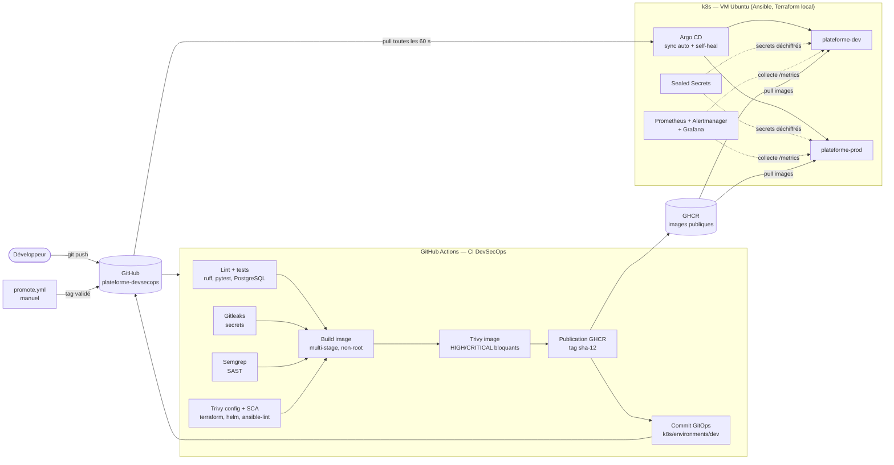
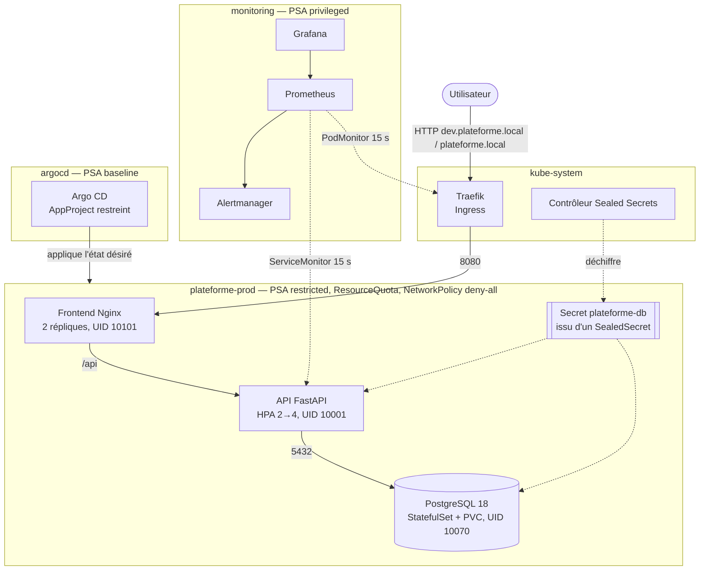

# Architecture

Deux vues : la **chaîne DevSecOps** (du commit au cluster) et l'**exécution dans k3s**.
Sources Mermaid : `*.mmd` (rendues nativement par GitHub ci-dessous). Exports PNG régénérables avec :

```bash
docker run --rm -u "$(id -u):$(id -g)" -v "$PWD/docs/architecture:/data" minlag/mermaid-cli:11.17.1 \
  -i /data/chaine-devsecops.mmd -o /data/chaine-devsecops.png -b white -s 2
```

## 1. Chaîne DevSecOps




| Étape | Outil | Bloquant | Preuve |
|---|---|---|---|
| Qualité | ruff, pytest (+ PostgreSQL de service) | oui | 20 tests, couverture ≥ 90 % |
| Secrets | Gitleaks (historique) | oui | PR #1 bloquée |
| SAST | Semgrep (python, bandit, security-audit…) | oui | contrôle positif |
| IaC + SCA | Trivy config/fs, terraform validate, helm lint, ansible-lint | oui | PR #2 bloquée (CVE-2020-14343) |
| Image | build multi-stage → Trivy image | oui (HIGH/CRITICAL corrigeables) | image naïve bloquée |
| Publication | GHCR, tag `sha-<12>` | — | images publiques |
| Déploiement | commit GitOps → Argo CD (pull) | — | push → dev en 189 s |

## 2. Exécution dans k3s




## 3. Couches de sécurité (défense en profondeur)

| Couche | Mesures |
|---|---|
| Code | SAST, revue, tests (dont injection SQL), SecretStr |
| Dépendances | versions figées, SCA Trivy, ≥ 2 semaines de recul (sauf correctif de sécurité) |
| Image | slim/distroless-like, non-root UID > 10000, sans pip, scan bloquant, SBOM |
| Chaîne CI | permissions `{}`, actions épinglées par SHA, jetons éphémères, CI sans accès au cluster |
| Cluster | PSA restricted, securityContext, sans jeton SA, NetworkPolicy deny-all, quotas |
| Secrets | Sealed Secrets (portée strict), chiffrement au repos k3s |
| Déploiement | GitOps, AppProject restreint, self-heal (dérive corrigée en 2 s) |
| Hôte | UFW, sysctl CIS, k3s durci (audit, secrets chiffrés, protect-kernel-defaults) |
| Détection | Prometheus + 4 alertes, détection d'une panne en 63–94 s |

## 4. Environnements

| | dev | prod |
|---|---|---|
| Mise à jour | automatique à chaque commit sur main | manuelle (`promote.yml`) |
| API | 1 réplique | HPA 2 → 4 |
| Frontend | 1 | 2 |
| Accès | http://dev.plateforme.local | http://plateforme.local |
| État désiré | `k8s/environments/dev/values.yaml` | `k8s/environments/prod/values.yaml` |

## 5. Limites connues

- Nœud unique : pas de haute disponibilité réelle (perte de la VM = perte du service).
- 2 vCPU : ≈ 70 % du CPU consommé au repos par la plateforme complète ; 4 vCPU recommandés.
- Pas de TLS sur l'Ingress local, pas de canal de notification externe pour les alertes.
- État GitOps dans le dépôt applicatif : `main` ne peut pas exiger les checks (push direct de la CI).
