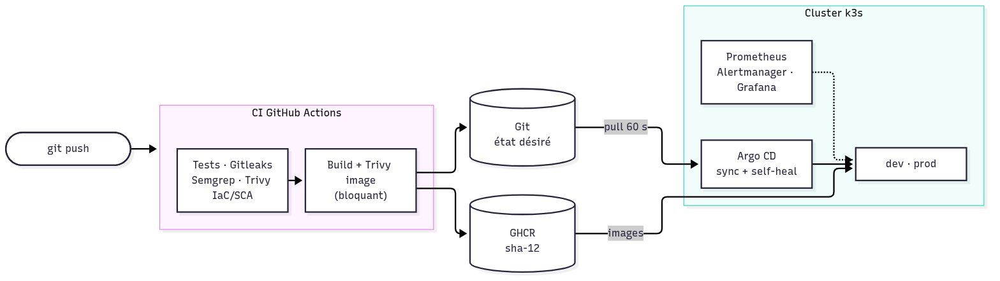

<!-- _class: titre -->
<!-- _paginate: false -->

# Plateforme DevSecOps de déploiement continu sur Kubernetes

Du `git push` à la production : automatisé, sécurisé, observé — **et mesuré**

Ghassen KAHIA — élève ingénieur en Cloud Computing
Projet personnel · Octobre 2026

<span class="petit">github.com/Ghassen-kahia/plateforme-devsecops</span>

---

# Contexte et problématique

Une équipe qui déploie **à la main** :

- étapes répétitives → **erreurs humaines**
- aucun contrôle de sécurité → secrets et **CVE en production**
- pas de rollback maîtrisé, pas de supervision → pannes découvertes **par les clients**

> Comment automatiser le déploiement sur Kubernetes de façon **reproductible**, avec des contrôles de sécurité **bloquants**, un **rollback** vérifié et des **alertes**, pour 0 € ?

---

# Objectifs et contraintes

| Objectif | Critère de réussite |
|---|---|
| Chaîne automatisée | `git push` → production sans intervention |
| Sécurité bloquante | Démontrée par des cas qui **doivent** échouer |
| GitOps + rollback | Dérive corrigée, retour arrière par Git |
| Supervision | Une panne réelle détectée et notifiée |
| Preuves | Chaque chiffre **mesuré**, méthode documentée |

**Contraintes** : VM Ubuntu **2 vCPU / 11 Gio**, k3s single-node, coût nul, AWS **écrit mais jamais appliqué**

---

# Architecture



<span class="petit">La CI écrit l'état désiré dans Git — elle n'a **aucun accès** au cluster (modèle pull)</span>

---

# Choix techniques

| Besoin | Choix | Pourquoi (vs alternative) |
|---|---|---|
| Kubernetes | **k3s** | Léger (2 vCPU), Traefik + NetworkPolicy inclus (vs minikube/kind) |
| CI | **GitHub Actions** | Pas de serveur, jetons éphémères, GHCR natif (vs Jenkins) |
| Sécurité | **Gitleaks, Semgrep, Trivy** | CLI sans serveur (vs SonarQube ≈ 2 Go RAM) |
| GitOps | **Argo CD** | Interface, AppProject = moindre privilège (vs Flux) |
| Secrets | **Sealed Secrets** | Chiffrés dans Git, sans service externe |
| Observabilité | **kube-prometheus-stack** | Standard, alertes livrées avec l'application |
| IaC | **Terraform + Ansible** | Créer (API) vs configurer (OS) |

---

# Pipeline CI DevSecOps

**4 contrôles en parallèle** → build → scan → publication → GitOps

| Étape | Bloque si… |
|---|---|
| ruff + 20 tests (PostgreSQL réel), couverture ≥ 90 % | régression |
| Gitleaks (historique Git) | secret détecté |
| Semgrep (SAST) | motif dangereux |
| Trivy config + SCA, terraform, helm, ansible-lint | IaC ou dépendance vulnérable |
| Trivy image | HIGH/CRITICAL **corrigeable** |

**Chaîne d'approvisionnement** : `permissions: {}`, actions épinglées par **SHA**, outils à somme vérifiée, versions ≥ 2 semaines… **sauf correctif de sécurité** (Argo CD 3.5.4)

---

# Les contrôles bloquent vraiment

| Cas qui doit échouer | Résultat |
|---|---|
| PR #1 : clé factice commitée | **Bloquée** par Gitleaks (valeur masquée) |
| PR #2 : `pyyaml==5.3.1` | **Bloquée** par Trivy (CVE-2020-14343 CRITICAL) |
| Image `python:3.12.15` | **Bloquée** (12 HIGH corrigeables) |
| Pod root en namespace *restricted* | **Refusé** par Pod Security Admission |
| Autre namespace → PostgreSQL | **Bloqué** (et autorisé sans policy : contrôle positif) |

Image API : **3 695 → 166** vulnérabilités, 0 CRITICAL · **1,69 GB → 221 MB** · non-root

<span class="petit">Un scanner silencieux ne prouve rien : chaque contrôle a été confronté à un cas positif</span>

---

# Déploiement GitOps

- **Argo CD** compare Git et le cluster toutes les 60 s → applique
- **App of apps** + **AppProject** : 1 dépôt, 2 namespaces, aucune ressource cluster
- **Sealed Secrets** : mot de passe chiffré dans Git, lié au nom et au namespace
- **dev** automatique · **prod** par promotion manuelle (même image)

| Mesure | Résultat |
|---|---|
| `git push` → nouvelle version en dev | **189 s** sans intervention |
| Rollback `git revert` | **89 s**, 0 erreur / 1 460 requêtes |
| NetworkPolicy supprimée à la main | rétablie en **2 s** |

---

# Supervision et panne contrôlée

**4 alertes** : base indisponible (cause), API indisponible (symptôme), **5xx mesurées à l'Ingress** (utilisateur), latence p95

Panne de PostgreSQL **déclenchée par Git**, trafic simulé :

| Jalon | Délai |
|---|---|
| 1re alerte reçue par Alertmanager | **+63 s** |
| 3 alertes critiques | **+94 s** |
| `git revert` → service rétabli | 166 s |

<span class="petit">Les 5xx sont mesurées à Traefik : API hors service = elle ne voit plus les requêtes</span>

---

# Démonstration

```bash
bash scripts/demo.sh etat        # Argo CD, versions servies, alertes
bash scripts/demo.sh securite    # PSA, non-root, NetworkPolicy, SealedSecret
bash scripts/demo.sh derive      # kubectl scale → annulé par Argo CD
bash scripts/demo.sh panne --oui # panne via Git → alertes → git revert
```

[CAPTURE : pipeline GitHub Actions vert] · [CAPTURE : Argo CD Synced/Healthy]
[CAPTURE : tableau de bord Grafana] · [CAPTURE : Alertmanager pendant la panne]

---

# Résultats mesurés

| Indicateur | Avant / manuel | Après / automatisé |
|---|---|---|
| Déploiement | 84 s de commandes, **0 contrôle** | 189 s, **20 tests + 5 analyses**, tracé |
| Vulnérabilités image API | 3 695 (16 CRITICAL) | 166 (0 CRITICAL) |
| Rollback | manuel, risque d'incohérence | 89 s par `git revert` |
| Dérive manuelle | invisible | corrigée en 2 à 6 s |
| Détection d'une panne | par les utilisateurs | 63–94 s |
| Erreurs pendant une mise à jour | 10 / 99 | **0 / 3 337** |

<span class="petit">Mesures ponctuelles (VM 2 vCPU) — méthode et limites dans docs/mesures.md</span>

---

# Difficultés et solutions

| Problème observé | Cause trouvée | Solution |
|---|---|---|
| 502 pendant une release | Label de version → **PostgreSQL redémarrait** | Pod DB sans label de version |
| 502 pendant une mise à jour réussie | SIGTERM avant retrait des endpoints | `preStop` sleep 5 s → 0 erreur |
| Alertes dev/prod fusionnées | `sum()` supprime le label `namespace` | Label explicite dans les règles |
| VM gelée 25 min → charge 52 | Suspension par l'hôte, cascade de redémarrages | Reprise auto ; *dead man's switch* ; 4 vCPU |
| Commit poussé malgré un échec | **Mon erreur** : `;` au lieu de `&&` | CI l'a bloqué ; validations chaînées |

---

# Perspectives

- **Cloud** : appliquer le module Terraform AWS → **EKS** + Karpenter
- **Secrets** : **Vault** / AWS Secrets Manager + External Secrets (rotation)
- **Réseau** : **service mesh** (mTLS), cert-manager (TLS)
- **Supply chain** : signature **cosign**, admission Kyverno, provenance SLSA
- **GitOps** : dépôt séparé, `main` protégé, webhook
- **Supervision** : SLO et *burn rate*, alerte externe (dead man's switch), Loki

---

<!-- _class: titre -->

# Merci

**Ce que je retiens** : mesurer plutôt que supposer,
prouver chaque contrôle par un cas qui doit échouer,
documenter les limites — y compris mes erreurs.

Questions ?

<span class="petit">Code, rapport, mesures : github.com/Ghassen-kahia/plateforme-devsecops</span>
