```{=latex}
\input{garde.tex}
```

# Introduction générale {.unnumbered}

```{=latex}
\markboth{Introduction générale}{}
```

Les entreprises livrent aujourd'hui leurs applications à un rythme sans commune mesure avec celui
d'il y a dix ans. Cette accélération pose une tension bien connue : livrer **vite** et livrer
**sûr** semblent contradictoires. Une équipe qui déploie à la main multiplie les gestes répétitifs,
donc les erreurs ; une équipe qui automatise sans garde-fous propage plus rapidement ses
vulnérabilités jusqu'en production.

Le mouvement **DevOps** a répondu à la première partie du problème par l'automatisation et la
mesure. Le **DevSecOps** prolonge cette démarche en intégrant la sécurité *dans* la chaîne de
livraison, au lieu de la reléguer à un contrôle final. Enfin, l'approche **GitOps** fait du dépôt
Git la seule source de vérité de l'infrastructure et des déploiements.

Ce rapport présente la conception, la réalisation et l'évaluation d'une **plateforme DevSecOps de
déploiement continu sur Kubernetes**, réalisée au sein du **RIF (Rassemblement des Ingénieurs
Francophones)** sous l'encadrement de M. Tawfik KESKES. Concrètement, chaque modification poussée
sur GitHub est automatiquement testée, analysée sur le plan de la sécurité, empaquetée dans une
image de conteneur, publiée, puis déployée sur un cluster Kubernetes par un agent GitOps, sous
supervision et avec alertes.

Le fil conducteur du projet est une exigence de **preuve** : chaque contrôle de sécurité a été
confronté à un cas qu'il *doit* bloquer, et chaque résultat chiffré présenté dans ce document
provient d'une mesure réelle, dont la méthode et les limites sont précisées.

Le rapport est organisé en six chapitres. Le **premier** présente le contexte, la problématique et
la démarche. Le **deuxième** dresse un état de l'art des pratiques et des outils. Le **troisième**
détaille l'analyse des besoins et la conception. Le **quatrième**, le plus long, décrit la
réalisation, illustrée par des captures de la plateforme en fonctionnement. Le **cinquième**
présente les tests et les résultats mesurés, et le **sixième** les difficultés rencontrées et
leurs solutions. Une conclusion ouvre enfin sur les perspectives.

# Contexte général du projet

## Organisme d'accueil

Ce projet a été réalisé au sein du **RIF --- Rassemblement des Ingénieurs Francophones**, dans le
cadre de ma formation d'ingénieur en Cloud Computing à **ESPRIT** (École Supérieure Privée
d'Ingénierie et de Technologies), sous l'encadrement de **M. Tawfik KESKES**.

[À COMPLÉTER : présentation de l'organisme d'accueil --- missions, activités, organisation,
et place du projet dans ses activités.]

## Problématique

Le projet part d'un scénario fréquent dans les équipes informatiques : une application est déployée
**manuellement**, par une suite de commandes exécutées par un opérateur. Cette situation présente
plusieurs risques, résumés dans le tableau \ref{tab:risques}.

| Situation actuelle | Risque | Conséquence |
|---|---|---|
| Déploiement manuel, étapes répétitives | Erreur humaine | Indisponibilité, environnements incohérents |
| Aucune détection de secrets | Mot de passe ou jeton commité | Compromission de comptes |
| Aucune analyse des dépendances et des images | Vulnérabilité connue (CVE) en production | Exploitation d'une faille publique |
| Modifications manuelles non tracées | Dérive entre la documentation et la réalité | Pannes difficiles à diagnostiquer |
| Pas de stratégie de retour arrière | Version défectueuse bloquée en production | Indisponibilité prolongée |
| Pas de supervision ni d'alertes | Panne découverte par les utilisateurs | Temps de détection long |

: Risques de la situation initiale \label{tab:risques}

La problématique peut donc se formuler ainsi :

> *Comment automatiser le déploiement d'une application sur Kubernetes de façon reproductible, en
> intégrant des contrôles de sécurité bloquants à chaque étape, une stratégie de retour arrière
> vérifiée et une supervision avec alertes, sans coût d'infrastructure ?*

## Objectifs du projet

Les objectifs ont été définis de manière à être **vérifiables** :

1. **Automatisation complète** : un `git push` déclenche toute la chaîne, jusqu'au déploiement,
   sans intervention humaine.
2. **Sécurité bloquante** : détection de secrets, analyse statique du code (SAST), analyse des
   dépendances (SCA), des images et de l'infrastructure (IaC). Chaque contrôle doit être
   **démontré** par un cas qui doit échouer.
3. **Déploiement GitOps** : Git est la source de vérité ; les dérives manuelles sont corrigées
   automatiquement et le retour arrière se fait par Git.
4. **Supervision** : métriques de l'application et du cluster, tableau de bord et alertes ; une
   panne réelle doit être détectée.
5. **Mesure** : chaque résultat est mesuré, avec une méthode documentée.

## Contraintes

| Contrainte | Détail |
|---|---|
| Environnement | Machine virtuelle Ubuntu 24.04 (VMware), **2 vCPU**, 11 Gio de RAM, 79 Go de disque |
| Cluster | Kubernetes **k3s** à un seul nœud |
| Coût | 0 € : services gratuits uniquement (GitHub, GHCR) |
| Cloud | Module Terraform AWS écrit et validé, **jamais appliqué** (pour éviter tout coût) |
| Sécurité | Aucun secret réel dans le dépôt ; aucune action destructive sans validation |
| Langue | Documentation intégralement en français |

: Contraintes du projet \label{tab:contraintes}

## Démarche et planification

Le projet a été découpé en **onze phases**, chacune livrée, vérifiée puis versionnée par un commit
avant de passer à la suivante. Cette démarche incrémentale permet de toujours disposer d'un état
fonctionnel et de localiser rapidement l'origine d'une régression.

| Phase | Contenu | Livrable principal |
|---|---|---|
| 0 | Audit de l'environnement | Diagnostic de la VM, outillage de base |
| 1 | Application de démonstration | API FastAPI, frontend, PostgreSQL, tests |
| 2 | Conteneurisation sécurisée | Images durcies, politique Trivy |
| 3 | Infrastructure as Code | Modules Terraform, rôles Ansible |
| 4 | Kubernetes et Helm | Cluster k3s, chart Helm, environnements dev et prod |
| 5 | Pipeline CI DevSecOps | Workflow GitHub Actions, PR de démonstration |
| 6 | GitOps | Argo CD, Sealed Secrets, promotion |
| 7 | Supervision | Prometheus, Grafana, alertes, panne contrôlée |
| 8 | Documentation | README, architecture, script de démonstration |
| 9 | Rapport | Le présent document |
| 10 | Soutenance | Présentation et script oral |

: Phases du projet \label{tab:phases}

Chaque phase a fait l'objet d'un journal d'apprentissage (concepts, commandes, erreurs rencontrées
et questions d'entretien) et d'un relevé de mesures, conservés dans le dépôt
(`docs/apprentissage.md`, `docs/mesures.md`). Le code source complet est public :
<https://github.com/Ghassen-kahia/plateforme-devsecops>.

# État de l'art

Ce chapitre présente les notions et les familles d'outils sur lesquelles repose la plateforme, puis
compare les principales alternatives pour justifier les choix effectués.

## DevOps et intégration / déploiement continus

Le DevOps désigne un ensemble de pratiques visant à rapprocher développement et exploitation, grâce
à l'automatisation, au partage des responsabilités et à la mesure. Deux pratiques en sont le cœur :

- l'**intégration continue (CI)** : chaque modification est automatiquement construite et testée,
  ce qui détecte les régressions au plus tôt ;
- le **déploiement continu (CD)** : chaque version validée peut être déployée automatiquement.

Les travaux du programme DORA, synthétisés dans l'ouvrage *Accelerate* (Forsgren, Humble, Kim,
2018), ont relié la performance des équipes à quatre indicateurs : la fréquence de déploiement, le
délai de mise en production, le taux d'échec des changements et le temps de restauration du service.
Ce projet en mesure des équivalents à son échelle : délai entre le push et la mise en service, temps
de retour arrière et temps de détection d'une panne.

## DevSecOps

Le DevSecOps intègre la sécurité tout au long de la chaîne (« *shift left* ») : plus une faille est
détectée tôt, moins elle coûte à corriger. Chaque famille de contrôles répond à une question précise
(tableau \ref{tab:controles}).

| Contrôle | Question posée | Exemple d'outil |
|---|---|---|
| Détection de secrets | Un mot de passe ou un jeton a-t-il été commité ? | Gitleaks, TruffleHog |
| SAST (analyse statique) | Le code contient-il des motifs dangereux ? | Semgrep, SonarQube, CodeQL |
| SCA (composition logicielle) | Une dépendance a-t-elle une vulnérabilité connue ? | Trivy, Grype, Snyk |
| Analyse d'image | Les paquets de l'image ont-ils des CVE ? | Trivy, Grype, Docker Scout |
| Analyse IaC | Terraform, Kubernetes ou Dockerfile sont-ils mal configurés ? | Trivy, Checkov, KICS |
| Chaîne d'approvisionnement | Les outils et dépendances de la chaîne sont-ils intègres ? | Épinglage, signatures, SLSA |

: Familles de contrôles DevSecOps \label{tab:controles}

Les **CVE** (*Common Vulnerabilities and Exposures*) identifient de manière unique les
vulnérabilités publiques ; leur sévérité est classée en LOW, MEDIUM, HIGH et CRITICAL. Une notion
importante en pratique est la différence entre une vulnérabilité **corrigée** (un correctif existe :
il faut mettre à jour) et une vulnérabilité **sans correctif** (aucune action immédiate n'est
possible). Elle a guidé la politique de blocage de ce projet.

Enfin, la **sécurité de la chaîne d'approvisionnement logicielle** est devenue un sujet majeur après
plusieurs attaques visant les outils de construction plutôt que les applications elles-mêmes. Le
cadre **SLSA** (*Supply-chain Levels for Software Artifacts*) et le guide **NIST SP 800-190** sur la
sécurité des conteneurs ont servi de références.

## Conteneurs et orchestration

Un **conteneur** isole un processus et ses dépendances grâce aux mécanismes du noyau Linux
(*namespaces* pour l'isolation, *cgroups* pour la limitation des ressources). Contrairement à une
machine virtuelle, il partage le noyau de l'hôte : il est donc léger, mais son isolation est plus
faible, ce qui rend indispensable son durcissement (exécution sans privilèges, capacités réduites,
système de fichiers en lecture seule).

**Kubernetes** orchestre des conteneurs à partir d'un **état désiré** décrit dans des manifestes :
il place les conteneurs (*pods*) sur les nœuds, les redémarre en cas de défaillance, répartit la
charge et applique des mises à jour progressives. Plusieurs distributions conviennent à un
environnement de laboratoire (tableau \ref{tab:k8s}).

| Critère | k3s | minikube | kind | kubeadm |
|---|---|---|---|---|
| Nature | Distribution certifiée, binaire unique | Cluster dans une VM ou un conteneur | Nœuds dans des conteneurs Docker | Outil d'installation standard |
| Empreinte | Faible | Moyenne | Faible | Élevée |
| Composants inclus | Ingress (Traefik), DNS, stockage, NetworkPolicy, metrics-server | Modules complémentaires | Minimal | Aucun |
| Usage typique | Edge, nœuds légers, production possible | Développement local | Tests CI éphémères | Clusters de production |
| Proximité d'un vrai nœud | Forte (service systemd) | Moyenne | Faible | Forte |

: Comparaison des distributions Kubernetes \label{tab:k8s}

**Choix retenu : k3s**, pour sa faible consommation (décisive avec 2 vCPU), ses composants inclus,
et son installation proche de celle d'un serveur réel, entièrement automatisable avec Ansible.

## Infrastructure as Code

L'**Infrastructure as Code (IaC)** décrit l'infrastructure dans des fichiers versionnés, relus et
testés comme du code. Deux familles d'outils sont complémentaires :

- **Terraform** : outil **déclaratif** à état, qui *crée* des ressources via des API (réseau,
  machines, objets Kubernetes) et calcule un plan de différences avant de les appliquer ;
- **Ansible** : outil **procédural** et idempotent, sans agent, qui *configure* l'intérieur d'une
  machine (paquets, fichiers, services) via SSH.

## Comparaison des outils d'intégration continue

| Critère | Jenkins | GitHub Actions | GitLab CI |
|---|---|---|---|
| Hébergement | Auto-hébergé (serveur à maintenir) | SaaS ou runners auto-hébergés | SaaS ou auto-hébergé |
| Configuration | Jenkinsfile (Groovy) + plugins | YAML dans `.github/workflows` | YAML `.gitlab-ci.yml` |
| Écosystème | Très large catalogue de plugins, qualité variable | Place de marché d'actions | Intégré à la plateforme GitLab |
| Coût pour un dépôt public | Coût du serveur | Gratuit (runners hébergés) | Quotas de minutes |
| Sécurité de la chaîne | Plugins à maintenir, surface d'attaque du serveur | Jetons éphémères, permissions par job, épinglage par SHA | Jetons de job, environnements protégés |
| Intégration au registre | Plugins | GHCR natif | Registre GitLab natif |

: Comparaison Jenkins / GitHub Actions / GitLab CI \label{tab:ci}

**Choix retenu : GitHub Actions** : le code est hébergé sur GitHub, l'authentification auprès du
registre GHCR passe par un jeton éphémère (aucun secret longue durée à gérer), aucun serveur n'est à
opérer et le service est gratuit pour un dépôt public. Jenkins aurait imposé un serveur
supplémentaire sur une machine déjà contrainte.

## GitOps

Formalisé par Weaveworks en 2017, puis par le groupe de travail OpenGitOps de la CNCF, le GitOps
repose sur quatre principes :

1. l'état du système est **déclaratif** ;
2. il est **versionné et immuable** dans Git ;
3. il est **tiré automatiquement** (*pull*) par un agent ;
4. il est **réconcilié en continu** : toute différence entre Git et la réalité est corrigée.

La différence avec un pipeline qui exécute lui-même `kubectl apply` (modèle *push*) est essentielle
pour la sécurité : dans le modèle *pull*, la CI n'a **aucun identifiant** sur le cluster.

| Critère | Argo CD | Flux |
|---|---|---|
| Statut CNCF | Projet diplômé | Projet diplômé |
| Interface | Interface web riche (graphe des ressources, historique) | Pas d'interface officielle |
| Architecture | Serveur + contrôleur + repo-server | Contrôleurs modulaires (GitOps Toolkit) |
| Multi-équipes | AppProject (sources, destinations, types de ressources) | Namespaces et comptes de service |
| Secrets | Outils externes (Sealed Secrets, plugins) | Intégration native avec SOPS |
| Mise à jour automatique des images | Projet séparé (Image Updater) | Contrôleurs intégrés |

: Comparaison Argo CD / Flux \label{tab:gitops}

**Choix retenu : Argo CD**, pour sa visibilité (utile en démonstration) et pour ses *AppProjects*,
qui appliquent le principe du moindre privilège à l'outil de déploiement lui-même.

## Gestion des secrets

| Solution | Principe | Avantages | Limites |
|---|---|---|---|
| Secret Kubernetes « brut » | Valeur encodée en Base64 | Simple | Base64 **n'est pas** un chiffrement : inutilisable dans Git |
| **Sealed Secrets** | Chiffrement asymétrique ; seul le contrôleur du cluster déchiffre | Secrets versionnables dans Git, aucun service externe | Clé privée à sauvegarder, pas de rotation centralisée |
| SOPS | Chiffrement de fichiers (KMS, age, PGP) | Souple, multi-outils | Gestion des clés à organiser |
| External Secrets + Vault | Secrets hors de Git, synchronisés depuis un coffre | Rotation, audit, centralisation | Service supplémentaire à opérer |

: Comparaison des solutions de gestion des secrets \label{tab:secrets}

## Observabilité

L'**observabilité** permet de comprendre l'état d'un système à partir de ses signaux : métriques,
journaux et traces. Pour un service web, la méthode **RED** (Rate, Errors, Duration) résume
l'essentiel : débit de requêtes, taux d'erreurs et latence. **Prometheus** collecte des métriques
par interrogation périodique (*scraping*) et évalue des règles d'alerte ; **Alertmanager** regroupe
et achemine les alertes ; **Grafana** les visualise.

Le livre *Site Reliability Engineering* de Google (2016) distingue les alertes sur les **symptômes**
(ce que subit l'utilisateur), qui doivent prévenir quelqu'un, des alertes sur les **causes**, qui
accélèrent le diagnostic. Cette distinction a guidé la conception des alertes de ce projet.

## Synthèse des choix

| Besoin | Outil retenu | Alternative principale écartée | Raison |
|---|---|---|---|
| Orchestration | k3s | minikube, kind | Légèreté, composants inclus, proximité d'un nœud réel |
| CI | GitHub Actions | Jenkins | Pas de serveur, jetons éphémères, GHCR natif |
| Secrets dans le code | Gitleaks | TruffleHog | Rapide, règles maintenues, mode PR et historique |
| SAST | Semgrep | SonarQube | CLI sans serveur (SonarQube : serveur et base, environ 2 Go de RAM) |
| Images, dépendances, IaC | Trivy | Grype, Snyk | Un seul outil pour tout, gratuit, sans serveur |
| GitOps | Argo CD | Flux | Interface, AppProjects |
| Secrets dans Git | Sealed Secrets | Vault | Aucun service externe à opérer |
| Supervision | kube-prometheus-stack | VictoriaMetrics, SaaS | Standard, CRD (ServiceMonitor, PrometheusRule) |
| IaC | Terraform + Ansible | Pulumi, user-data | Créer (API) et configurer (OS) |

: Synthèse des choix techniques \label{tab:choix}

# Analyse des besoins et conception

## Acteurs

| Acteur | Rôle | Interactions avec la plateforme |
|---|---|---|
| Développeur | Fait évoluer l'application | `git push`, ouverture de pull requests, lecture des résultats de la CI |
| Responsable de la mise en production | Décide de déployer en production | Déclenche la promotion vers prod |
| Exploitant | Garantit la disponibilité | Consulte Grafana et Alertmanager, effectue les retours arrière par Git |
| Utilisateur final | Utilise l'application | Accède à l'interface web |

: Acteurs de la plateforme \label{tab:acteurs}

## Besoins fonctionnels

- **BF1** --- Fournir une application web de gestion de tâches (API et interface) persistant ses
  données dans PostgreSQL.
- **BF2** --- Exposer des points d'exploitation : vivacité (`/health`), disponibilité (`/ready`)
  et métriques (`/metrics`).
- **BF3** --- Construire, tester, analyser et publier automatiquement chaque version.
- **BF4** --- Déployer automatiquement en **dev** chaque version validée, et en **prod** sur
  décision humaine, avec exactement la même image.
- **BF5** --- Revenir à une version antérieure.
- **BF6** --- Détecter une panne et émettre une alerte.

## Besoins non fonctionnels

| Exigence | Traduction technique | Vérification prévue |
|---|---|---|
| Sécurité | Contrôles bloquants, conteneurs non-root, réseau en *deny-all*, secrets chiffrés | Cas qui doivent échouer (PR, pods, flux réseau) |
| Reproductibilité | IaC, versions figées, procédures idempotentes | Clone neuf, `--check`, `plan` sans changement |
| Disponibilité | Probes, mises à jour progressives, autoscaling | Sonde continue pendant les déploiements |
| Observabilité | Métriques RED, alertes, tableau de bord | Panne contrôlée |
| Traçabilité | Tout changement passe par Git | Historique des commits GitOps |
| Sobriété | 2 vCPU, 0 € | Mesures de consommation |

: Besoins non fonctionnels \label{tab:bnf}

## Architecture générale

L'architecture se découpe en trois zones de confiance (figure \ref{fig:chaine}) :

1. **GitHub** (code, CI, registre GHCR) : la CI teste, analyse, construit et publie ; elle écrit la
   nouvelle version dans Git, **sans aucun accès au cluster** ;
2. **Git**, source de vérité : les fichiers `k8s/environments/<env>/values.yaml` décrivent la
   version et la configuration de chaque environnement ;
3. **le cluster k3s** : Argo CD lit Git et applique l'état désiré, Sealed Secrets déchiffre les
   secrets, et Prometheus surveille l'ensemble.

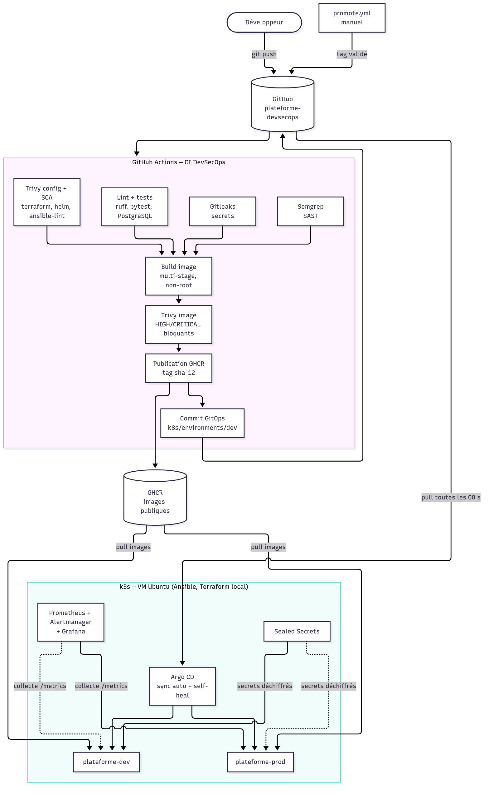{height=80%}

## Architecture d'exécution

Dans le cluster (figure \ref{fig:exec}), chaque environnement dispose de son propre *namespace*,
protégé par le niveau *restricted* des Pod Security Standards, par des quotas de ressources et par
une politique réseau qui interdit tout flux non explicitement autorisé. Les utilisateurs accèdent à
l'application via l'Ingress Traefik ; le frontend Nginx relaie les appels `/api` vers l'API
FastAPI, qui seule peut joindre PostgreSQL.

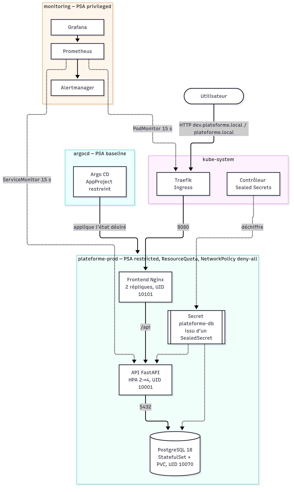{height=80%}

## Choix de conception structurants

**Séparation de la vivacité et de la disponibilité.** La sonde de vivacité (`/health`) ne dépend
pas de la base de données ; la sonde de disponibilité (`/ready`) la vérifie. Ainsi, une panne de la
base retire les pods de l'API du trafic **sans les redémarrer** en boucle, ce qui aggraverait
l'incident.

**Image immuable promue.** Une image est construite et analysée **une seule fois**, identifiée par un
tag dérivé du commit (`sha-` suivi des 12 premiers caractères). C'est cette même image qui est
déployée en dev, puis promue en prod : ce qui a été testé est exactement ce qui est livré.

**Modèle *pull*.** La CI n'écrit que dans Git. Même si un pipeline était compromis, il ne pourrait
pas modifier directement le cluster.

**Supervision livrée avec l'application.** Les règles d'alerte et la configuration de collecte font
partie du chart Helm de l'application : elles évoluent avec elle, dans les mêmes revues de code.

**Défense en profondeur.** Aucune mesure n'est supposée suffisante seule : chaque couche (code,
dépendances, image, chaîne CI, cluster, réseau, secrets, hôte) dispose de ses propres protections.

## Organisation du dépôt

| Répertoire | Contenu |
|---|---|
| `app/` | API FastAPI, frontend, tests, Dockerfiles, Docker Compose |
| `infra/terraform/` | Module local (socle Kubernetes) et module AWS (non appliqué) |
| `infra/ansible/` | Rôles de préparation et de durcissement de l'hôte, installation de k3s |
| `k8s/helm/plateforme/` | Chart Helm de l'application |
| `k8s/environments/` | État désiré GitOps de chaque environnement |
| `k8s/argocd/` | Application racine, projet Argo CD, valeurs d'installation |
| `monitoring/` | Configuration de la supervision et tableau de bord Grafana |
| `.github/workflows/` | Pipeline CI DevSecOps et workflow de promotion |
| `scripts/` | Installation des outils, amorçage GitOps, démonstration |
| `docs/` | Journal d'apprentissage, mesures, sécurité, architecture, rapport |

: Organisation du dépôt \label{tab:depot}

# Réalisation

Ce chapitre décrit la mise en œuvre, phase par phase. Toutes les captures ont été réalisées sur la
plateforme en fonctionnement (les horaires des interfaces Grafana et Prometheus sont affichés en
UTC, soit l'heure locale moins deux heures).

## Environnement de travail

L'environnement est une machine virtuelle VMware sous Ubuntu 24.04.5 LTS (2 vCPU Intel i5-11400H,
11 Gio de RAM, 79 Go de disque). Un audit initial a précédé toute installation ; il a révélé deux
points d'attention qui se sont confirmés par la suite : **la contrainte CPU**, et le fait que
**Docker contourne le pare-feu UFW** pour les ports qu'il publie (d'où la publication des ports de
développement sur `127.0.0.1` uniquement).

Les outils sont installés « juste à temps » par le script `scripts/install.sh`, phase par phase,
depuis les dépôts officiels ou depuis des binaires dont la **somme SHA-256 est vérifiée**. Les
versions sont figées, et choisies avec au moins deux semaines de recul, sauf correctif de sécurité.

| Outil | Version | Rôle |
|---|---|---|
| Docker Engine / Compose | 29.9.0 / v5.6.0 | Construction et exécution locale des conteneurs |
| k3s | v1.36.5+k3s1 | Cluster Kubernetes |
| Helm / kubectl | 4.3.0 / 1.36.5 | Déploiement et administration |
| Terraform / Ansible | 1.16.6 / core 2.16 | Infrastructure as Code |
| Trivy / Gitleaks / Semgrep | 0.74.0 / 8.30.1 / 1.178.0 | Analyses de sécurité |
| Argo CD / Sealed Secrets | 3.5.4 / 0.40.0 | GitOps et secrets |
| kube-prometheus-stack | 91.8.2 | Prometheus, Grafana, Alertmanager |

: Principaux outils et versions \label{tab:outils}

## Application de démonstration

L'application est volontairement simple, pour concentrer l'effort sur l'infrastructure : une API
**FastAPI** (Python 3.12) de gestion de tâches, une base **PostgreSQL 18**, et une interface web
statique servie par **Nginx**, qui relaie les appels `/api` vers l'API (une seule origine pour le
navigateur, donc aucune configuration CORS).

{width=85%}

L'API expose, outre les opérations sur les tâches, trois points d'exploitation : `/health`
(vivacité), `/ready` (disponibilité, qui vérifie la base) et `/metrics` (métriques Prometheus). Sa
documentation OpenAPI est générée automatiquement.

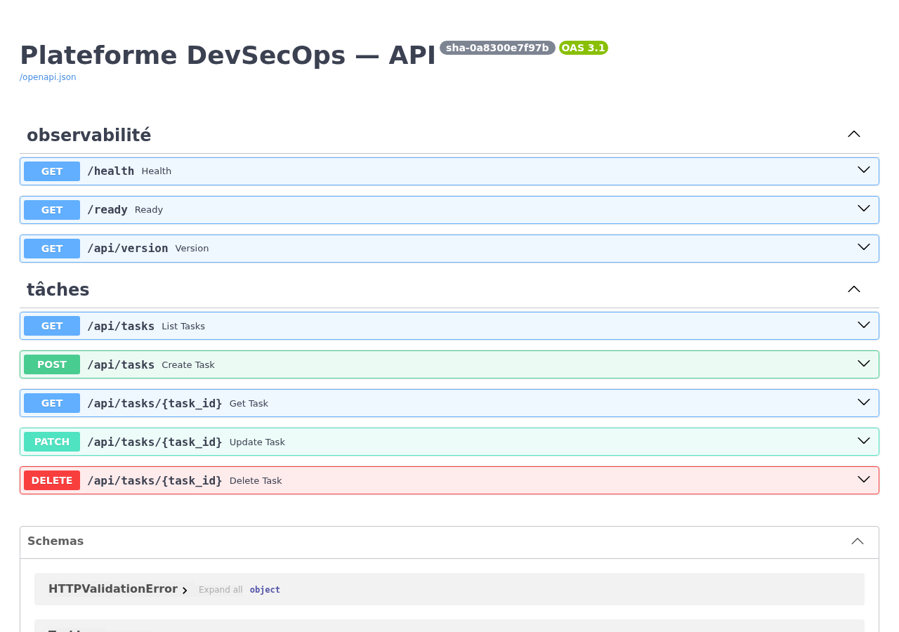{width=85%}

Les métriques suivent la méthode RED. Le label `route` utilise le **modèle** de route et non le
chemin réel, afin de maîtriser la cardinalité des séries temporelles :

```python
route = request.scope.get("route")
# modèle de route : /api/tasks/{task_id}, et non /api/tasks/42
route_label = getattr(route, "path", "<non_routé>")
HTTP_REQUESTS.labels(request.method, route_label, str(status)).inc()
HTTP_LATENCY.labels(request.method, route_label).observe(time.perf_counter() - start)
```

La sécurité applicative est intégrée dès cette étape : requêtes SQL paramétrées (testées avec une
charge d'injection), mot de passe manipulé comme `SecretStr` (jamais affiché dans les journaux),
message d'erreur 503 générique (le détail reste côté serveur), en-têtes de sécurité Nginx
(CSP, `X-Frame-Options`, `nosniff`) et affichage par `textContent` côté JavaScript contre le XSS.

Les **20 tests** (16 unitaires avec un dépôt en mémoire, 4 d'intégration contre un vrai
PostgreSQL) passent, avec une couverture de 99 % :

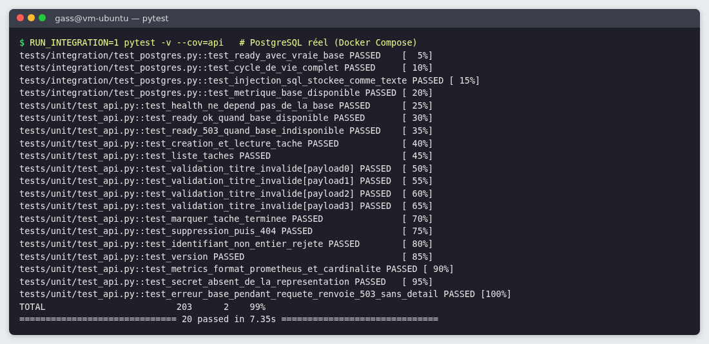{width=95%}

## Conteneurisation sécurisée

Une première image volontairement naïve (`FROM python:3.12.15`, exécution en root) a servi de
point de référence pour mesurer l'effet du durcissement. L'image finale applique :

- une construction **multi-étapes** : les dépendances sont installées dans un environnement virtuel,
  seul celui-ci est copié dans l'image finale ;
- une image de base **slim** (Debian 13), sans compilateurs ni documentation ;
- un utilisateur **non-root** à identifiant numérique fixe (10001), et le code possédé par root
  (non modifiable par le processus) ;
- la **suppression de pip** de l'image finale : impossible d'installer un paquet depuis un conteneur
  compromis ;
- un `.dockerignore` en **liste blanche**, qui empêche d'embarquer `.env`, `.git` ou `.venv`.

```dockerfile
FROM ${PYTHON_IMAGE} AS build                    # python:3.12.15-slim-trixie
RUN python -m venv /opt/venv
RUN /opt/venv/bin/pip install --no-compile -r /tmp/requirements.txt \
 && /opt/venv/bin/pip uninstall -y pip

FROM ${PYTHON_IMAGE} AS runtime
RUN groupadd --gid 10001 app \
 && useradd --uid 10001 --gid app --no-create-home --shell /usr/sbin/nologin app \
 && python -m pip uninstall -y --root-user-action=ignore pip
COPY --from=build /opt/venv /opt/venv
COPY --chown=root:root backend/api ./api
USER 10001:10001
```

La politique d'analyse (`trivy.yaml`, commune au poste de travail et à la CI) **bloque les
vulnérabilités HIGH et CRITICAL qui disposent d'un correctif**. Les vulnérabilités sans correctif
sont tracées dans les rapports, mais ne bloquent pas : aucune action n'étant possible, les bloquer
rendrait le pipeline rouge en permanence et pousserait à contourner le contrôle.

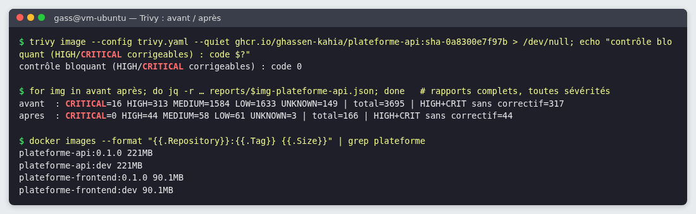{width=95%}

## Infrastructure as Code

**Terraform** est utilisé à deux niveaux :

- un module **AWS** (VPC, sous-réseau, groupe de sécurité, instance EC2 pour k3s, journaux de flux
  réseau), écrit, formaté, validé et analysé, mais **jamais appliqué**. Il impose notamment
  l'**IMDSv2** (protection des identifiants de l'instance contre les attaques SSRF), un disque
  chiffré, et refuse toute administration ouverte à `0.0.0.0/0` grâce à une validation de variable ;
- un module **local**, appliqué sur le cluster, qui crée les *namespaces* avec le niveau de sécurité
  *Pod Security Admission* adapté, des quotas de ressources et des valeurs par défaut.

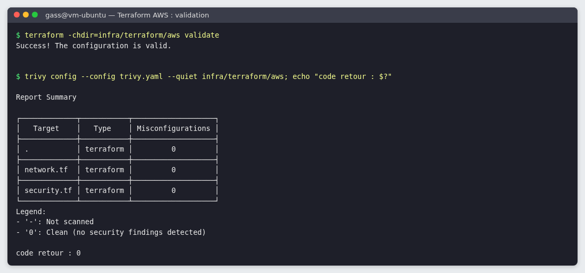{width=95%}

**Ansible** prépare et durcit l'hôte, puis installe k3s, au moyen de quatre rôles : `common`
(paquets, mises à jour automatiques, paramètres noyau inspirés des recommandations CIS),
`ssh_hardening`, `firewall` (UFW) et `k3s`. Le script d'installation de k3s est **figé au tag de
version et vérifié par SHA-256**, au lieu du classique `curl | sh` :

```yaml
- name: Télécharger le script d'installation k3s (somme SHA-256 vérifiée)
  ansible.builtin.get_url:
    url: "https://raw.githubusercontent.com/k3s-io/k3s/\
          {{ k3s_version | urlencode }}/install.sh"
    checksum: "sha256:{{ k3s_install_script_sha256 }}"
```

k3s est configuré avec le chiffrement des secrets au repos, la protection des paramètres noyau et un
journal d'audit de l'API. Le playbook est **idempotent** : une seconde exécution ne modifie rien.

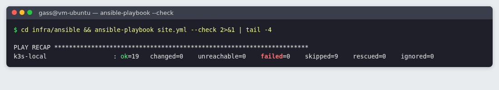{width=95%}

## Kubernetes et Helm

Un **chart Helm unique** (`k8s/helm/plateforme`) décrit l'API, le frontend, PostgreSQL
(StatefulSet avec volume persistant), l'Ingress Traefik, l'autoscaling horizontal (HPA), les
politiques réseau, la supervision et le secret chiffré. Les différences entre environnements se
limitent à quelques valeurs dans `k8s/environments/<env>/values.yaml`.

Tous les conteneurs respectent le niveau *restricted* des Pod Security Standards : exécution non-root
(UID supérieur à 10000), aucune escalade de privilèges, toutes les capacités Linux supprimées,
profil seccomp par défaut, système de fichiers en lecture seule et aucun jeton d'API monté. Les mises
à jour sont progressives (`maxUnavailable: 0`), avec un délai d'arrêt (`preStop`) qui évite de
servir des requêtes à un processus en cours d'arrêt.

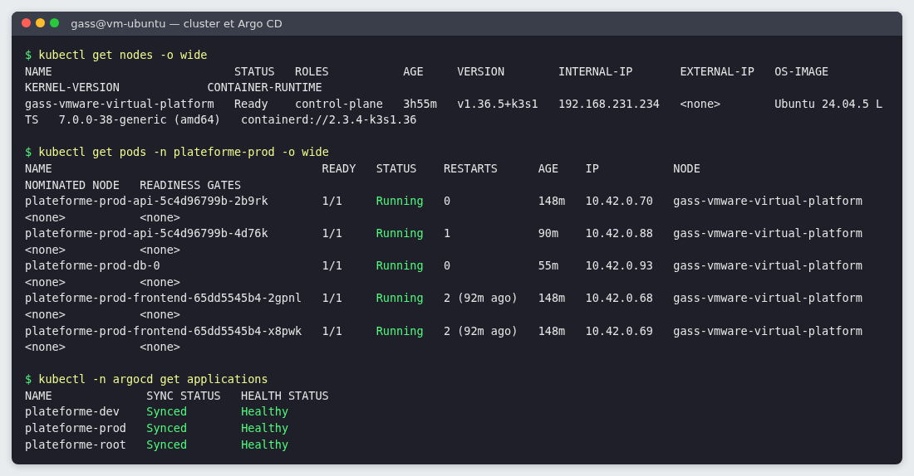{width=95%}

Le réseau suit un modèle **zéro confiance** : une politique interdit tout flux dans le *namespace*,
puis cinq flux sont explicitement autorisés (DNS, Traefik vers le frontend, frontend vers l'API,
supervision vers l'API, API vers PostgreSQL). La capture suivante montre ces contrôles vérifiés en
direct par le script de démonstration.

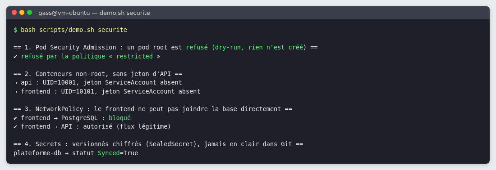{width=95%}

## Pipeline CI DevSecOps

Le pipeline (`.github/workflows/ci.yml`) enchaîne **quatre contrôles en parallèle** (lint et tests
avec une base PostgreSQL de service, détection de secrets, SAST, analyse IaC et des dépendances),
puis, seulement si tout est vert, la **construction**, l'**analyse** et la **publication** de chaque
image, et enfin la **mise à jour de l'état GitOps**.

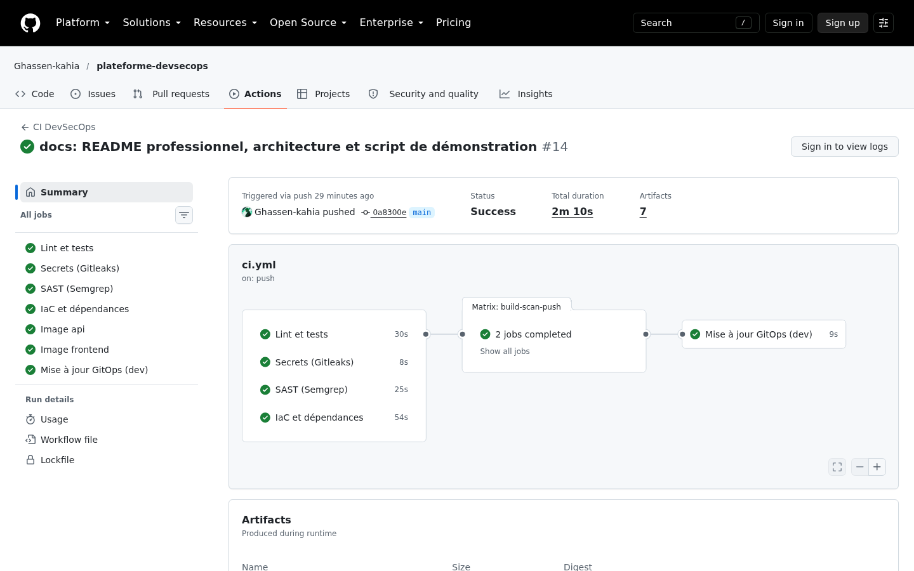{width=95%}

La chaîne elle-même est sécurisée :

```yaml
permissions: {}                       # aucune permission par défaut
jobs:
  build-scan-push:
    permissions:
      contents: read
      packages: write                 # uniquement pour publier dans GHCR
    steps:
      - uses: actions/checkout@3d3c42e5aac5ba805825da76410c181273ba90b1 # v7.0.1
```

- chaque job ne reçoit que les permissions dont il a besoin ;
- les actions tierces sont **épinglées par SHA de commit** (un tag peut être déplacé par un
  attaquant) ;
- les outils sont installés à version fixe, avec vérification de leur somme de contrôle ;
- l'authentification auprès de GHCR et le commit GitOps utilisent le **jeton éphémère** du run :
  aucun secret longue durée n'est nécessaire ;
- un rapport complet et un inventaire des composants (**SBOM** CycloneDX) sont conservés pour chaque
  image.

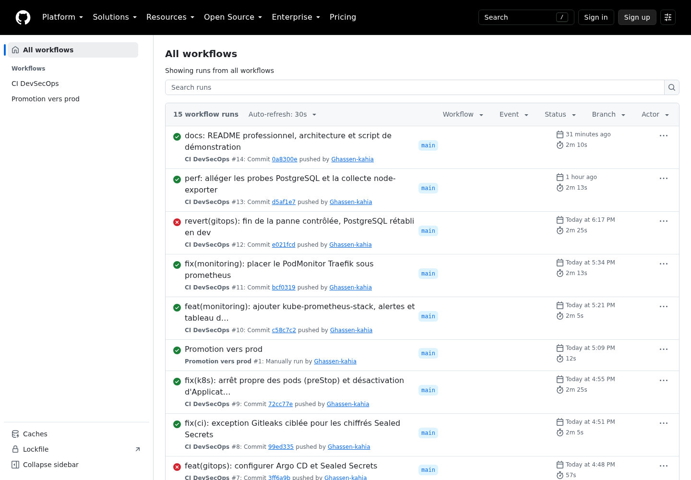{width=95%}

### Démonstration des contrôles bloquants

Pour prouver que les contrôles bloquent réellement, deux pull requests de démonstration ont été
ouvertes, puis fermées sans fusion. La première contient une **clé d'API factice** générée
aléatoirement :

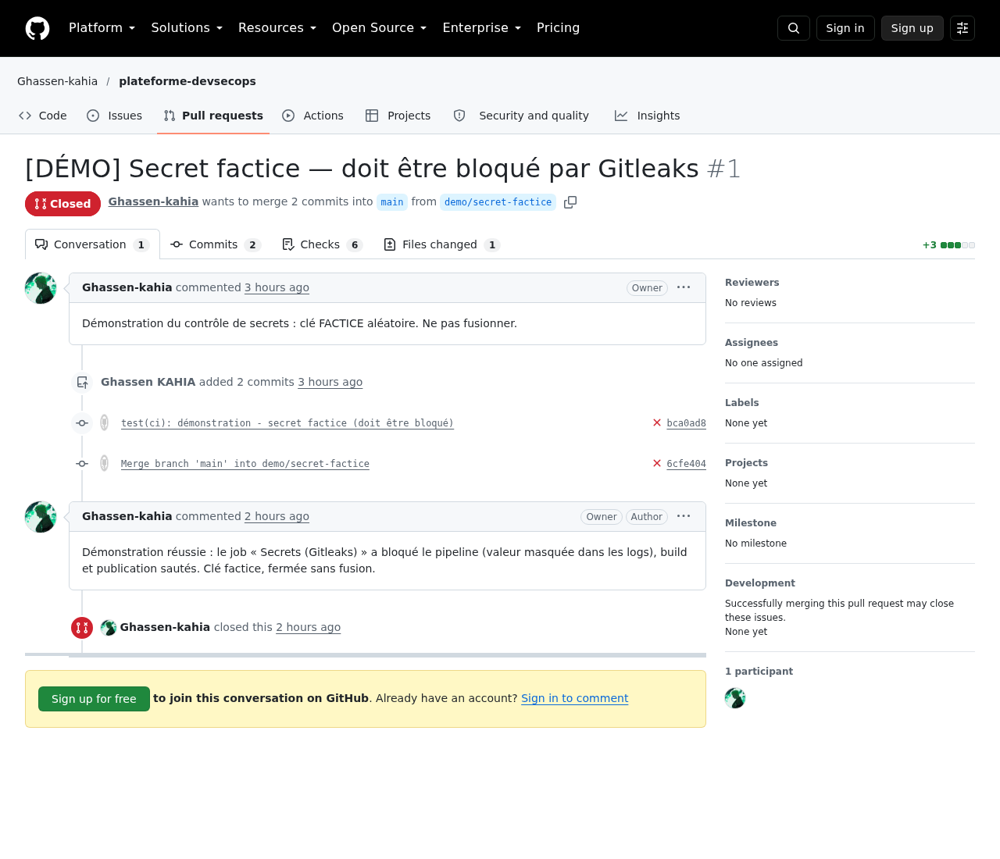{width=85%}

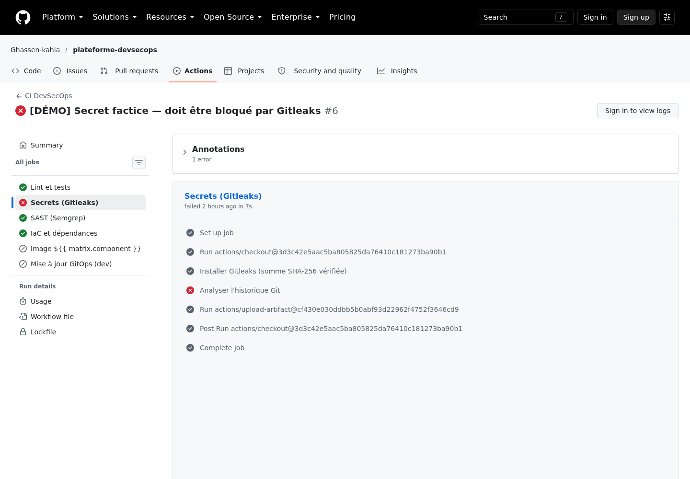{width=95%}

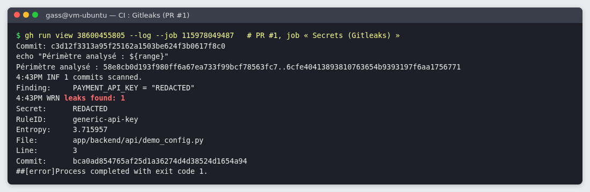{width=95%}

La seconde ajoute une dépendance vulnérable, `pyyaml==5.3.1` (CVE-2020-14343, CRITICAL, corrigée en
version 5.4) :

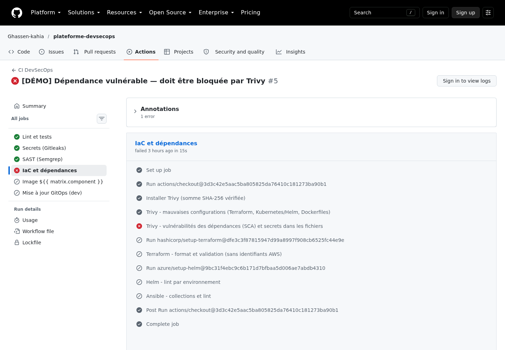{width=95%}

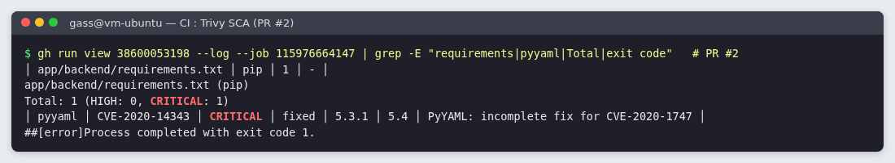{width=95%}

Dans les deux cas, **seul le contrôle concerné échoue**, et aucune image n'est construite ni publiée.

## Déploiement GitOps avec Argo CD

Argo CD, installé dans le cluster, compare toutes les 60 secondes l'état décrit dans Git à l'état
réel, et applique les différences. L'organisation suit le modèle « *app of apps* » : une application
racine gère les applications `plateforme-dev` et `plateforme-prod`. Un **AppProject** restreint leur
périmètre à un seul dépôt source, à deux *namespaces* de destination, et interdit toute ressource de
niveau cluster.

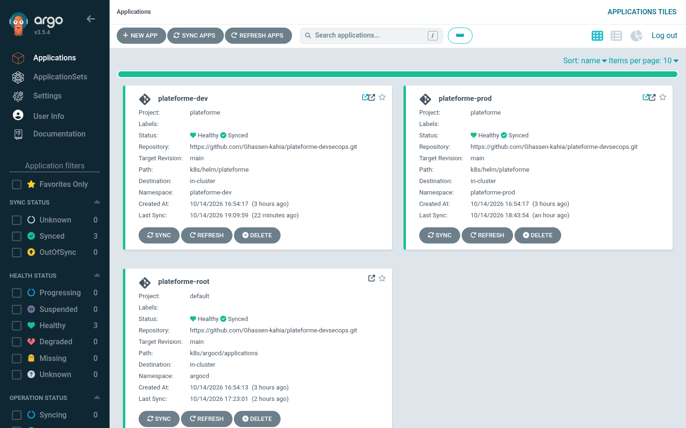{width=95%}

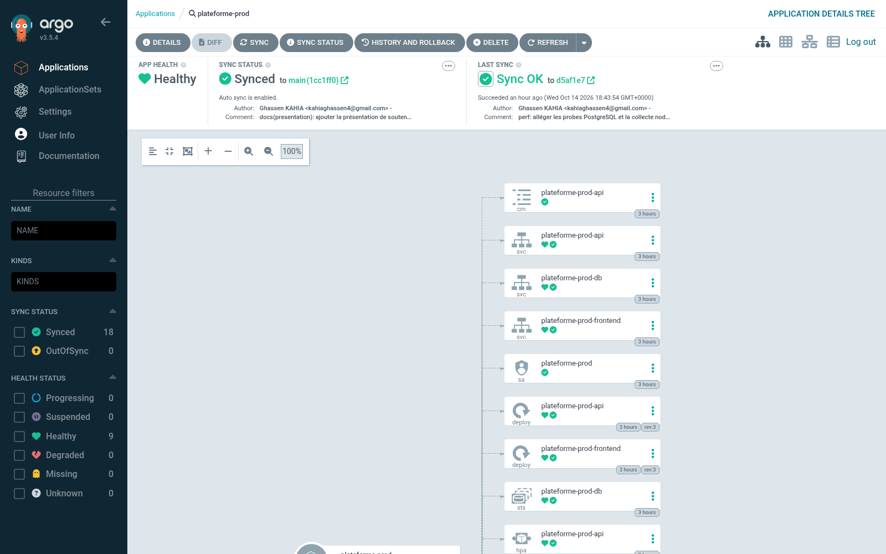{width=95%}

Le **self-heal** annule toute modification manuelle du cluster. Dans l'exemple ci-dessous, un
opérateur passe le frontend de 1 à 3 répliques à la main ; Argo CD rétablit l'état de Git en
quelques secondes.

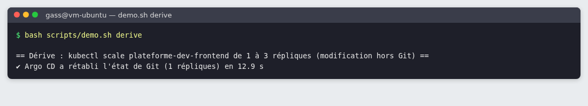{width=95%}

Les **secrets** sont versionnés **chiffrés** grâce à Sealed Secrets : seul le contrôleur du
cluster, qui détient la clé privée, peut les déchiffrer. La portée *strict* lie chaque texte chiffré
à un nom et à un *namespace* : rejoué ailleurs, il est refusé.

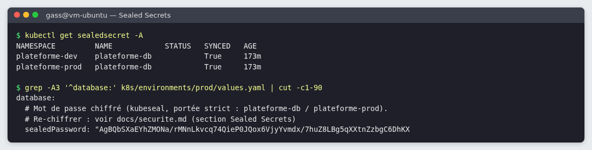{width=95%}

Enfin, la **promotion** vers la production est une décision humaine : le workflow `promote.yml`,
déclenché manuellement, recopie dans l'état de prod le tag déjà validé en dev. Aucune image n'est
reconstruite.

## Supervision et alertes

La supervision repose sur **kube-prometheus-stack**, installé avec un profil réduit adapté aux 2 vCPU
(rétention de 24 heures, composants inexistants dans k3s désactivés). Prometheus collecte les
métriques de l'API, de Traefik, des nœuds et des objets Kubernetes.

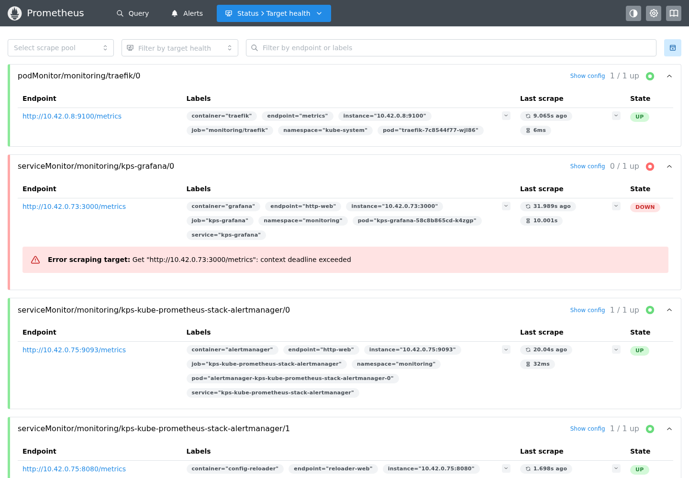{width=95%}

Le tableau de bord Grafana, provisionné depuis Git, présente les indicateurs RED, l'état de la
base, les répliques disponibles, la version déployée et la consommation des pods.

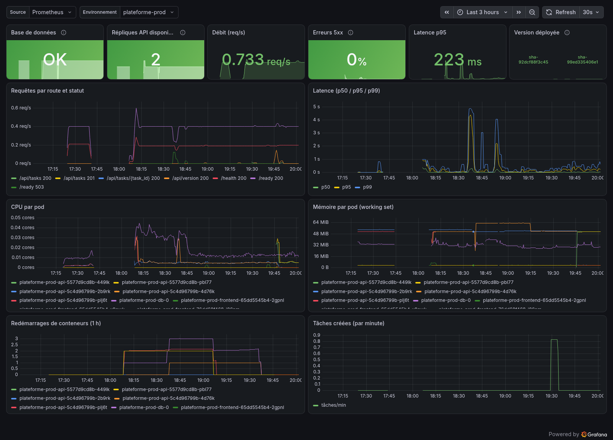{width=100%}

Quatre règles d'alerte sont livrées avec l'application, pour chaque environnement :

| Alerte | Nature | Condition | Délai (`for`) |
|---|---|---|---|
| PlateformeBaseDeDonneesIndisponible | Cause | La base ne répond plus aux vérifications de l'API | 30 s |
| PlateformeApiIndisponible | Symptôme | Aucune réplique de l'API disponible | 1 min |
| PlateformeTauxErreurs5xxEleve | Expérience utilisateur | Plus de 5 % de réponses 5xx **mesurées à l'Ingress** | 1 min |
| PlateformeLatenceP95Elevee | Dégradation | Latence p95 supérieure à 500 ms | 5 min |

: Règles d'alerte de l'application \label{tab:alertes}

Le taux d'erreurs est mesuré **au niveau de Traefik**, et non dans l'API : quand l'API est retirée
du service, elle ne reçoit plus les requêtes, et ses propres métriques ne voient aucune erreur.

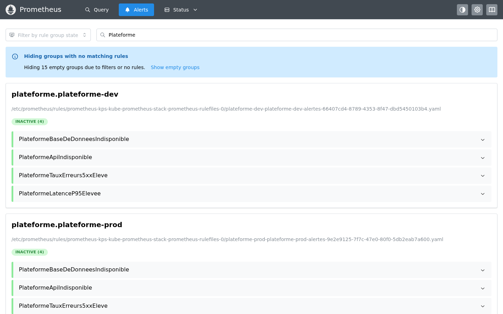{width=95%}

# Tests, résultats et évaluation

Toutes les mesures ont été réalisées sur l'environnement décrit au chapitre précédent, le
14 octobre 2026. Elles sont généralement issues d'un seul essai par scénario : elles donnent un
**ordre de grandeur**, et non une moyenne statistique. Leur méthode détaillée est consignée dans le
fichier `docs/mesures.md` du dépôt.

## Qualité et tests automatisés

| Mesure | Résultat |
|---|---|
| Tests unitaires | 16 réussis (dont 4 cas paramétrés) |
| Tests d'intégration contre PostgreSQL | 4 réussis (dont un test d'injection SQL) |
| Couverture de code | 99 % (seuil bloquant en CI : 90 %) |
| Analyse du code Python (ruff, règles de sécurité incluses) | 0 erreur |
| Analyse des rôles Ansible (ansible-lint, profil *production*) | 0 échec |
| Validation des workflows (actionlint + shellcheck) | 0 erreur |

: Résultats des tests et analyses de qualité \label{tab:qualite}

## Sécurité des images

| Image | CRITICAL | HIGH | Total | Taille | Utilisateur |
|---|---|---|---|---|---|
| API initiale (`python:3.12.15`) | 16 | 313 | 3 695 | 1,69 GB | root |
| API durcie (slim, multi-étapes) | **0** | 44 (sans correctif) | **166** | **221 MB** | 10001 |
| Frontend initial (`nginx:1.30.5`) | 1 | 67 | 401 | 240 MB | root |
| Frontend durci (unprivileged, Alpine) | **0** | **0** | **1** | **90,1 MB** | 10101 |

: Vulnérabilités et taille des images avant et après durcissement \label{tab:images}

Les dépendances de l'application ne présentaient **aucune** vulnérabilité : tout le risque venait de
l'image de base. Les 44 vulnérabilités HIGH restantes concernent des paquets essentiels de Debian
pour lesquels aucun correctif n'est publié ; elles sont tracées et réévaluées à chaque
reconstruction.

## Efficacité des contrôles bloquants

Un analyseur qui ne signale rien ne prouve rien. Chaque contrôle a donc été confronté à un cas qu'il
doit bloquer :

| Contrôle | Cas de test | Résultat |
|---|---|---|
| Gitleaks (CI) | PR \#1 : clé d'API factice | **Bloqué**, valeur masquée dans les journaux |
| Gitleaks | Secret supprimé dans un commit suivant | **Toujours bloqué** (le secret reste dans l'historique) |
| Trivy, dépendances (CI) | PR \#2 : `pyyaml==5.3.1` | **Bloqué** (CVE-2020-14343, CRITICAL) |
| Trivy, image | Image `python:3.12.15` | **Bloqué** (12 HIGH corrigeables) |
| Semgrep | Fichier volontairement vulnérable | 4 lignes sur 5 détectées (`yaml.load` non détecté) |
| Pod Security Admission | Pod `nginx` standard dans un *namespace* restricted | **Refusé** (4 violations) |
| NetworkPolicy | Autre *namespace* vers PostgreSQL | Autorisé sans politique, **bloqué** avec |
| Sealed Secrets | Texte chiffré rejoué dans un autre *namespace* | **Refusé** |

: Contrôles positifs \label{tab:positifs}

## Délais de déploiement et de retour arrière

| Scénario | Résultat |
|---|---|
| Déploiement manuel (construction, import, secret, Helm) | 84 s, **sans aucun contrôle** |
| Pipeline CI complet (7 jobs) | 125 à 145 s selon les exécutions |
| `git push` → nouvelle version servie en dev | **189 s**, sans intervention |
| Modification de configuration dans Git → active en dev | 49 s |
| Promotion vers prod → nouvelle version servie | 84 s |
| Retour arrière GitOps (`git revert`) → version précédente servie | **89 s** |

: Délais de déploiement \label{tab:delais}

Le déploiement automatisé n'est pas plus rapide que le déploiement manuel, et ce n'était pas
l'objectif : pour un délai du même ordre, il exécute 20 tests et cinq familles d'analyses de
sécurité, produit un SBOM et laisse un historique complet, **sans intervention humaine**.

## Disponibilité pendant les changements

Une sonde interroge le service toutes les 0,3 seconde via l'Ingress pendant chaque opération :

| Opération | Requêtes | Erreurs |
|---|---|---|
| Release défectueuse et retour arrière, avant correction du chart | 99 | 10 |
| Même scénario, après correction (2 essais) | 365 | **0** |
| Changement de configuration par GitOps | 939 | **0** |
| Retour arrière d'image par GitOps | 1 460 | **0** |
| Promotion vers la production | 938 | **0** |

: Erreurs observées par les utilisateurs pendant les changements \label{tab:dispo}

## Correction des dérives

| Modification manuelle | Corrigée par Argo CD en |
|---|---|
| Changement du nombre de répliques du frontend | 1,7 s |
| Suppression de la NetworkPolicy de PostgreSQL | 2,0 s |
| Modification d'une ConfigMap | 6,1 s |

: Temps de correction des dérives \label{tab:derives}

## Détection d'une panne contrôlée

Pour éprouver la supervision, une panne de la base de dev est provoquée **par un commit Git**
(`database.replicas: 0`), sous un trafic simulé de 3 requêtes par seconde, puis annulée par
`git revert`. Le journal horodaté de l'exercice est reproduit ci-dessous.

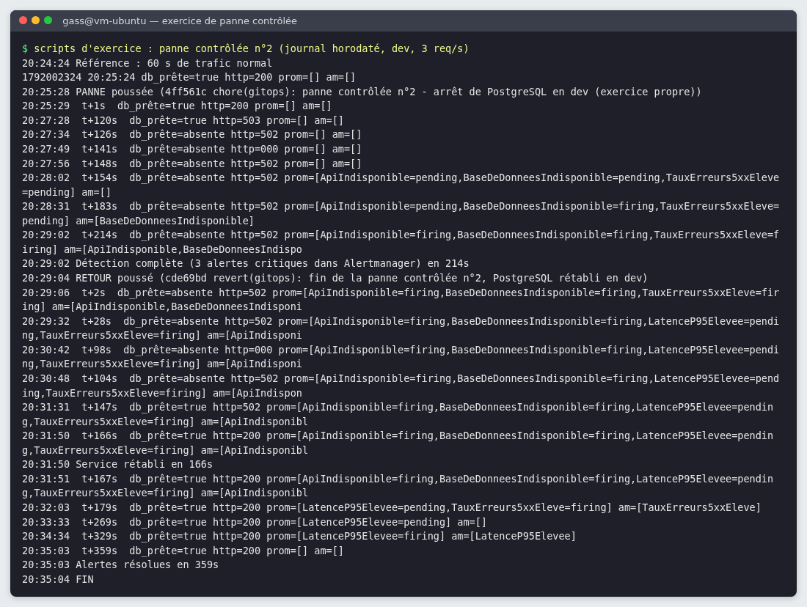{width=95%}

Les métriques enregistrées par Prometheus montrent l'impact réel : la disponibilité de la base
passe à 0, et, au point d'entrée, les réponses en succès laissent place aux erreurs 5xx.

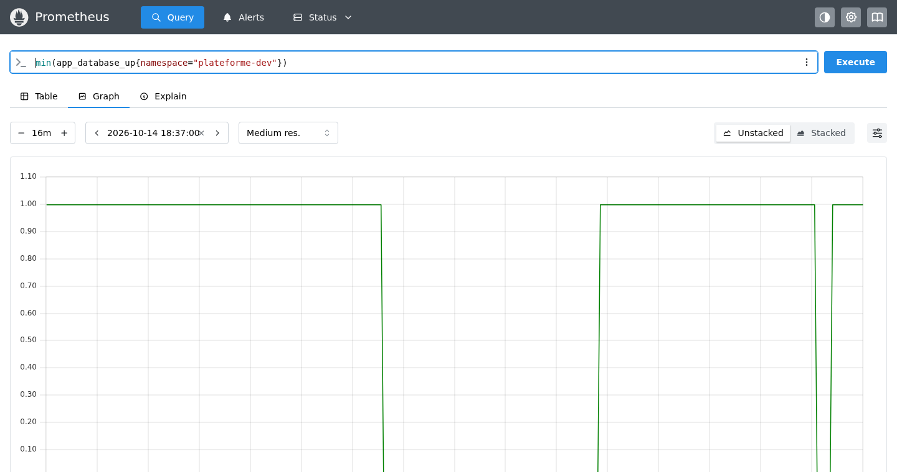{width=95%}

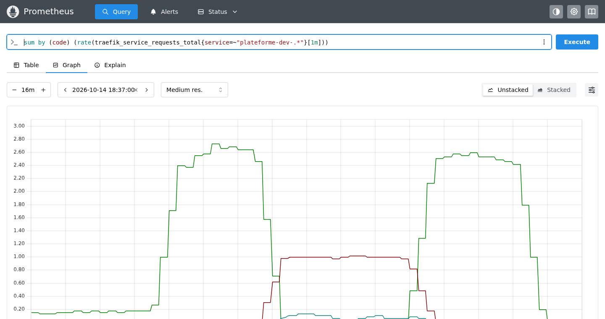{width=95%}

Les alertes atteignent ensuite Prometheus puis Alertmanager, chacune étiquetée avec son
environnement :

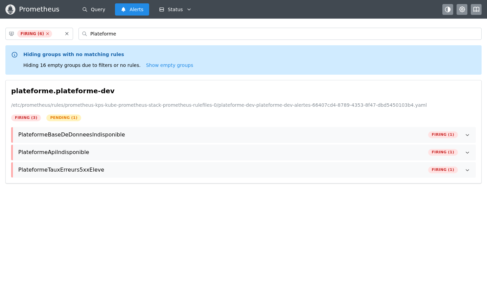{width=95%}

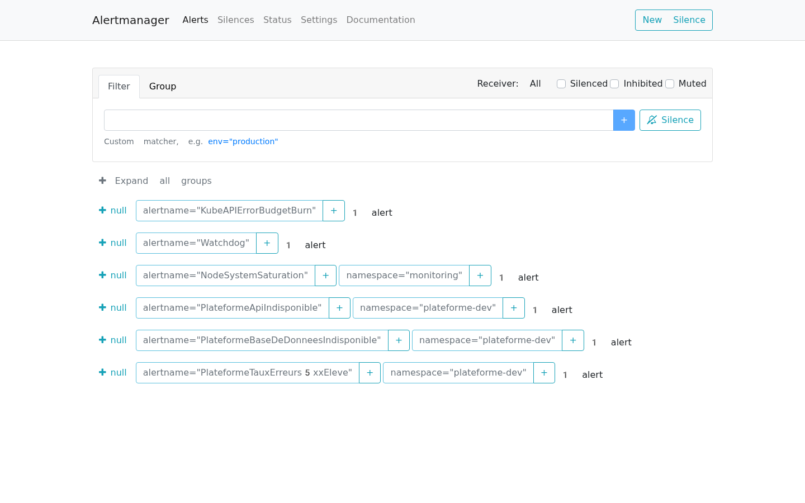{width=95%}

| Jalon (référence : première erreur vue par l'utilisateur) | Exercice 2 | Exercice 3 |
|---|---|---|
| Première alerte reçue par Alertmanager | +63 s | +33 s |
| Trois alertes critiques reçues par Alertmanager | +94 s | +93 s |
| `git revert` poussé → service rétabli | 166 s | 107 s |

: Délais de détection et de rétablissement \label{tab:detection}

On note aussi, sur la capture d'Alertmanager, deux alertes génériques du cluster
(`NodeSystemSaturation`, `KubeAPIErrorBudgetBurn`) : elles signalent la saturation de la machine
virtuelle à 2 vCPU, un point traité dans le chapitre suivant.

## Autoscaling et quotas

| Mesure | Résultat |
|---|---|
| HPA sous charge (24 clients pendant 180 s) | 2 → 4 répliques en environ 34 s |
| Retour à 2 répliques | 121 s (fenêtre de stabilisation de 120 s) |
| Quota du *namespace* dev : 20 répliques demandées | 2 créées (limite de CPU atteinte) |

: Autoscaling et quotas \label{tab:hpa}

## Consommation de ressources

| État | Mesure |
|---|---|
| VM au démarrage (bureau seul) | 2,2 Gio de RAM |
| k3s et deux environnements | environ 3,8 Gio, 9 % de CPU |
| Avec Argo CD et Sealed Secrets | environ 4,8 Gio, 12 % de CPU |
| Avec la supervision complète | environ 5,6 Gio ; **environ 67 à 73 % des 2 vCPU au repos** |

: Consommation de ressources \label{tab:ressources}

La plateforme complète fonctionne sur 2 vCPU, mais avec une marge faible, ce qui s'est traduit par
plusieurs incidents (chapitre suivant). Le passage à 4 vCPU, recommandé dès l'audit initial, est
confirmé.

## Synthèse

| Objectif | Atteint | Preuve |
|---|---|---|
| Chaîne automatisée du push au déploiement | Oui | 189 s, sans intervention |
| Contrôles de sécurité bloquants | Oui | 2 PR bloquées, 8 contrôles positifs |
| GitOps et retour arrière | Oui | Dérives corrigées en 2 à 6 s ; `git revert` en 89 s |
| Supervision et alertes | Oui | Panne détectée en une à deux minutes |
| Mesure des résultats | Oui | Toutes les valeurs de ce chapitre |

: Synthèse de l'atteinte des objectifs \label{tab:synthese}

# Difficultés rencontrées et solutions

Les difficultés présentées ici sont celles réellement rencontrées. Pour chacune, la démarche a été
la même : observer, formuler une hypothèse, la vérifier isolément, corriger, puis **mesurer de
nouveau**.

## Erreurs pendant une release défectueuse

**Symptôme.** Pendant le déploiement d'une version dont l'image était introuvable, 10 % des
requêtes ont échoué, alors que l'ancienne version restait en service.

**Diagnostic.** La corrélation des journaux de Nginx et des événements Kubernetes a montré que
**PostgreSQL redémarrait** à chaque déploiement : le label `app.kubernetes.io/version`, qui suit la
version de l'application, figurait dans le modèle de pod de la base. Chaque release modifiait donc
ce modèle, ce qui provoquait un redémarrage.

**Correction.** Un modèle de pod sans label de version pour PostgreSQL. Résultat : 0 erreur sur
365 requêtes.

**Piège méthodologique.** Un second essai a d'abord montré 9 erreurs. Trois hypothèses testées
isolément ont été réfutées, puis une bissection a montré que la mesure avait démarré trop tôt,
pendant la stabilisation provoquée par le correctif lui-même. Leçon : toujours mesurer à partir d'un
état stable.

## Erreurs pendant une mise à jour réussie

**Cause.** Lors de l'arrêt d'un pod, Kubernetes envoie le signal d'arrêt au conteneur **en même
temps** qu'il le retire de l'équilibrage de charge. Pendant le temps de propagation, quelques
requêtes atteignent un processus en cours d'arrêt.

**Correction.** Un délai `preStop` de 5 secondes (action native de Kubernetes) et un délai de grâce
adapté. Résultat : 0 erreur sur plus de 3 300 requêtes, sur trois déploiements.

**Enseignement.** Les tests précédents ne terminaient jamais l'ancien pod : un test ne couvre que ce
qu'il exerce réellement.

## Le piège du retour arrière hors de l'outil de déploiement

Un `kubectl rollout undo` suivi d'un `helm rollback` a produit un **état incohérent** : le pod
utilisait une configuration, la ConfigMap en contenait une autre. Cette démonstration a directement
motivé le passage à GitOps, où toute modification passe par Git et où les changements manuels sont
annulés.

## Faux positifs et exceptions de sécurité

- Un texte **chiffré** par Sealed Secrets était signalé comme « clé d'API » par Gitleaks. Une
  première exception fondée sur le chemin du fichier s'est révélée **trop large** : un contrôle
  positif a montré qu'elle masquait aussi un mot de passe en clair placé dans le même fichier.
  L'exception finale porte uniquement sur le format exact d'un texte chiffré.
- La branche de démonstration contenant le secret factice aurait fait échouer chaque semaine le scan
  complet de l'historique ; l'exception est limitée au SHA exact de ce commit.
- Après un changement de version, Trivy avait renommé ses identifiants de règles. Un scan sans
  aucune exception a permis de retirer deux exceptions qui ne correspondaient à aucun constat réel.

## Alertes indiscernables entre environnements

Lors du premier exercice de panne, les alertes étaient bien émises, mais **sans label
d'environnement** : les fonctions d'agrégation de Prometheus (`min`, `sum`) suppriment les labels.
Les alertes de dev et de prod auraient été identiques, donc fusionnées par Alertmanager. Un label
explicite a été ajouté à chaque règle ; la capture d'Alertmanager du chapitre précédent confirme le
correctif.

## Supervision silencieusement dégradée

En préparant les captures de ce rapport, Grafana s'est révélé **inutilisable** : une page mettait
quatre minutes à s'afficher, et ses sondes échouaient depuis environ deux heures. Grafana
consommait 273 millicœurs pour une limite de 300 : il était bridé en permanence, et ses accès à sa
base interne expiraient. Après relèvement de sa limite à un cœur, la même page s'affichait en
0,1 seconde.

L'enseignement est double : les limites de ressources doivent être **mesurées** et non estimées, et
**la supervision doit elle-même être supervisée**. Aucune alerte n'avait signalé cette panne.

## Gel de la machine virtuelle et cascade de redémarrages

**Faits.** Aucune ligne dans le journal système pendant 25 minutes, un trou équivalent dans
Prometheus, puis, au réveil, le nœud déclaré indisponible, des évictions et une charge de 52 sur
2 vCPU.

**Cause.** La machine virtuelle avait été suspendue par l'hôte. Au réveil, toutes les sondes ont
expiré en même temps, provoquant une vague de redémarrages qui a saturé le processeur.

**Résolution.** Le système s'est rétabli seul en environ 8 minutes.

**Enseignements.** Une supervision interne ne peut pas signaler que sa propre machine est figée :
c'est le rôle d'un mécanisme externe de type « *dead man's switch* » (alerte `Watchdog` envoyée en
permanence à un service extérieur). Par ailleurs, la mesure de la consommation au repos (environ
70 % des 2 vCPU) a confirmé l'insuffisance de la marge.

## Concurrence entre les commits humains et ceux de la CI

Lors d'une démonstration de panne, le commit de retour arrière a été **refusé** par GitHub : entre
temps, la CI avait poussé son propre commit GitOps. Le script s'est arrêté avant d'avoir rétabli la
base, et l'environnement de dev est resté en panne. Le script pousse désormais ses commits avec un
rebase et plusieurs tentatives, comme le fait déjà le job GitOps de la CI. Cet incident illustre une
limite du choix de stocker l'état GitOps dans le dépôt applicatif.

## Erreurs personnelles et garde-fous ajoutés

- **Un commit a été poussé malgré deux validations en échec**, parce que les étapes étaient enchaînées
  avec `;` au lieu de `&&`. La CI l'a bloqué, et aucune image n'a été publiée. Depuis, les
  validations sont strictement chaînées, et une détection de secrets est exécutée sur le contenu
  indexé avant chaque commit.
- Une clé YAML mal indentée (la collecte des métriques de Traefik placée sous la configuration de
  Grafana) a été **ignorée sans aucune erreur**. Une vérification de structure a été ajoutée.

# Conclusion générale et perspectives {.unnumbered}

```{=latex}
\markboth{Conclusion générale et perspectives}{}
```

Ce projet avait pour objectif de construire une plateforme capable d'emmener une application du
`git push` jusqu'à la production de façon automatisée, sécurisée et supervisée, sans coût
d'infrastructure. Cet objectif est atteint, et surtout **démontré** :

- la chaîne complète s'exécute en environ trois minutes, sans intervention humaine ;
- les contrôles de sécurité bloquent effectivement les cas prévus : secret factice, dépendance
  vulnérable, image vulnérable, pod privilégié, flux réseau interdit ;
- le déploiement GitOps corrige les modifications manuelles en quelques secondes et permet un
  retour arrière par `git revert` en moins d'une minute et demie, sans erreur pour les utilisateurs ;
- la supervision détecte une panne de la base de données en une à deux minutes ;
- les mises à jour se déroulent sans erreur, après correction de deux défauts révélés par la mesure.

Au-delà des outils, ce projet m'a appris une démarche : **mesurer plutôt que supposer**, confronter
chaque contrôle à un cas qui doit échouer, et documenter honnêtement les limites, y compris mes
propres erreurs.

## Limites {.unnumbered}

- Un seul nœud : aucune haute disponibilité réelle.
- 2 vCPU : marge insuffisante pour absorber une reprise après incident.
- Pas de chiffrement TLS sur l'Ingress local, et pas de canal de notification externe pour les
  alertes.
- État GitOps dans le dépôt applicatif : impossible d'exiger les vérifications sur la branche
  principale, et risque de concurrence entre commits.
- Module AWS validé statiquement uniquement.
- Mesures réalisées en un ou deux essais.

## Perspectives {.unnumbered}

| Axe | Évolution envisagée |
|---|---|
| Cloud | Appliquer le module Terraform AWS, puis migrer vers **Amazon EKS** avec Karpenter |
| Secrets | **HashiCorp Vault** ou AWS Secrets Manager, avec External Secrets Operator (rotation) |
| Réseau | **Service mesh** (Istio, Linkerd) pour le chiffrement mTLS ; cert-manager pour le TLS |
| Chaîne d'approvisionnement | Signature des images (cosign), politique d'admission (Kyverno), provenance SLSA |
| GitOps | Dépôt GitOps séparé, branche principale protégée, webhook |
| Supervision | Objectifs de niveau de service (SLO) et alertes sur le budget d'erreur ; supervision externe ; journaux centralisés (Loki) |
| Images | Images *distroless* pour supprimer les vulnérabilités sans correctif |

: Perspectives d'évolution \label{tab:perspectives}

# Bibliographie et webographie {.unnumbered}

```{=latex}
\markboth{Bibliographie et webographie}{}
```

1. Forsgren N., Humble J., Kim G. *Accelerate: The Science of Lean Software and DevOps*. IT
   Revolution, 2018.
2. Beyer B., Jones C., Petoff J., Murphy N. R. (dir.). *Site Reliability Engineering*. O'Reilly,
   2016. <https://sre.google/sre-book/monitoring-distributed-systems/>
3. Souppaya M., Morello J., Scarfone K. *Application Container Security Guide*. NIST SP 800-190,
   2017. <https://doi.org/10.6028/NIST.SP.800-190>
4. OpenGitOps (CNCF). *GitOps Principles v1.0.0*. <https://opengitops.dev/>
5. SLSA. *Supply-chain Levels for Software Artifacts*. <https://slsa.dev/>
6. Center for Internet Security. *CIS Benchmarks*. <https://www.cisecurity.org/cis-benchmarks>
7. k3s. *CIS Hardening Guide*. <https://docs.k3s.io/security/hardening-guide>
8. Kubernetes. *Pod Security Standards*.
   <https://kubernetes.io/docs/concepts/security/pod-security-standards/>
9. Kubernetes. *Network Policies*.
   <https://kubernetes.io/docs/concepts/services-networking/network-policies/>
10. Kubernetes. *Configure Liveness, Readiness and Startup Probes*.
    <https://kubernetes.io/docs/tasks/configure-pod-container/configure-liveness-readiness-startup-probes/>
11. GitHub. *Security hardening for GitHub Actions*.
    <https://docs.github.com/en/actions/security-for-github-actions/security-guides/security-hardening-for-github-actions>
12. Argo CD. *Documentation*. <https://argo-cd.readthedocs.io/>
13. Bitnami. *Sealed Secrets*. <https://github.com/bitnami/sealed-secrets>
14. Aqua Security. *Trivy*. <https://trivy.dev/>
15. Gitleaks. <https://github.com/gitleaks/gitleaks>
16. Semgrep. *Documentation*. <https://semgrep.dev/docs/>
17. Prometheus. *Documentation*. <https://prometheus.io/docs/>
18. Prometheus Community. *kube-prometheus-stack*. <https://github.com/prometheus-community/helm-charts>
19. OWASP. *Top 10* et *Docker Security Cheat Sheet*. <https://owasp.org/www-project-top-ten/>
20. HashiCorp. *Terraform Documentation*. <https://developer.hashicorp.com/terraform/docs>
21. Ansible. *Documentation*. <https://docs.ansible.com/>
22. FastAPI. *Documentation*. <https://fastapi.tiangolo.com/>

```{=latex}
\appendix
```

# Dépôt GitHub du projet

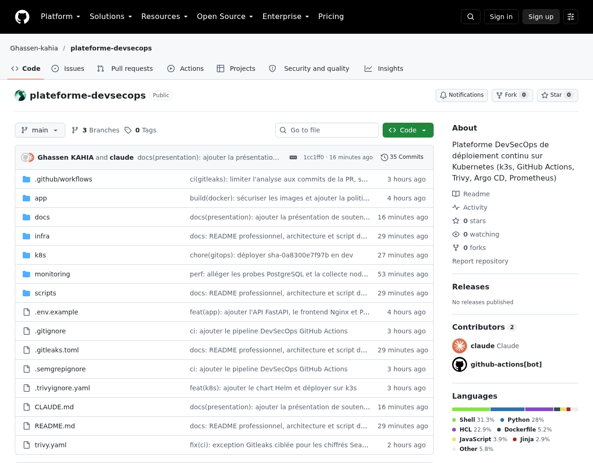{width=90%}

# Extraits de configuration

## Règle d'alerte (chart Helm)

```yaml
- alert: PlateformeTauxErreurs5xxEleve
  expr: |
    sum(rate(traefik_service_requests_total{service="<frontend>", code=~"5.."}[2m]))
      /
    sum(rate(traefik_service_requests_total{service="<frontend>"}[2m]))
      > 0.05
  for: 1m
  labels:
    severity: critical
    namespace: plateforme-prod
```

## Application Argo CD de l'environnement de production

```yaml
apiVersion: argoproj.io/v1alpha1
kind: Application
metadata:
  name: plateforme-prod
  namespace: argocd
spec:
  project: plateforme
  source:
    repoURL: https://github.com/Ghassen-kahia/plateforme-devsecops.git
    targetRevision: main
    path: k8s/helm/plateforme
    helm:
      releaseName: plateforme-prod
      valueFiles: [../../environments/prod/values.yaml]
  destination:
    server: https://kubernetes.default.svc
    namespace: plateforme-prod
  syncPolicy:
    automated: { prune: true, selfHeal: true }
```

## État désiré d'un environnement

```yaml
image:
  registry: "ghcr.io/ghassen-kahia"
  tag: "sha-92dcf88f3c45"   # CI (dev) ou promote.yml (prod)
ingress:
  host: plateforme.local
api:
  autoscaling: { enabled: true, minReplicas: 2, maxReplicas: 4 }
frontend:
  replicas: 2
database:
  sealedPassword: "AgBQbSXa…"      # texte chiffré par Sealed Secrets (extrait)
```

# Liste des abréviations

| Abréviation | Signification |
|---|---|
| API | *Application Programming Interface* |
| CD | *Continuous Delivery / Deployment* (déploiement continu) |
| CI | *Continuous Integration* (intégration continue) |
| CIS | *Center for Internet Security* |
| CNCF | *Cloud Native Computing Foundation* |
| CVE | *Common Vulnerabilities and Exposures* |
| GHCR | *GitHub Container Registry* |
| HPA | *Horizontal Pod Autoscaler* |
| IaC | *Infrastructure as Code* |
| IMDS | *Instance Metadata Service* (AWS) |
| PSA | *Pod Security Admission* |
| RED | *Rate, Errors, Duration* |
| SAST | *Static Application Security Testing* |
| SBOM | *Software Bill of Materials* |
| SCA | *Software Composition Analysis* |
| SLO | *Service Level Objective* |
| SLSA | *Supply-chain Levels for Software Artifacts* |
| SSRF | *Server-Side Request Forgery* |
| TLS | *Transport Layer Security* |
| VM | Machine virtuelle |

: Liste des abréviations \label{tab:abrev}
